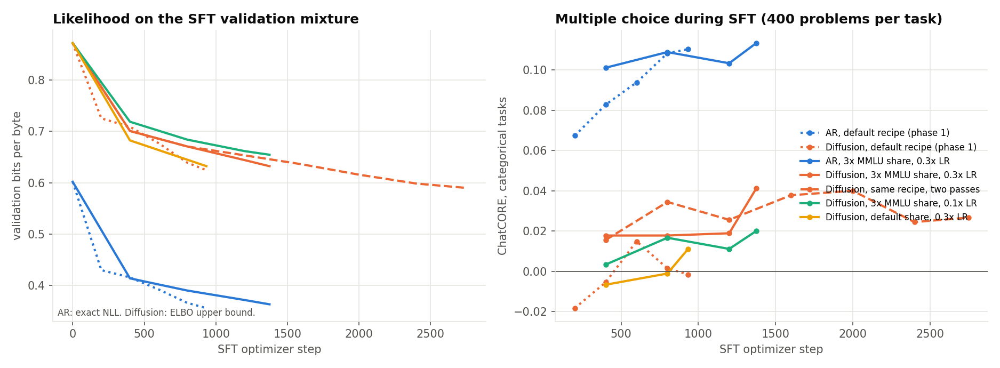
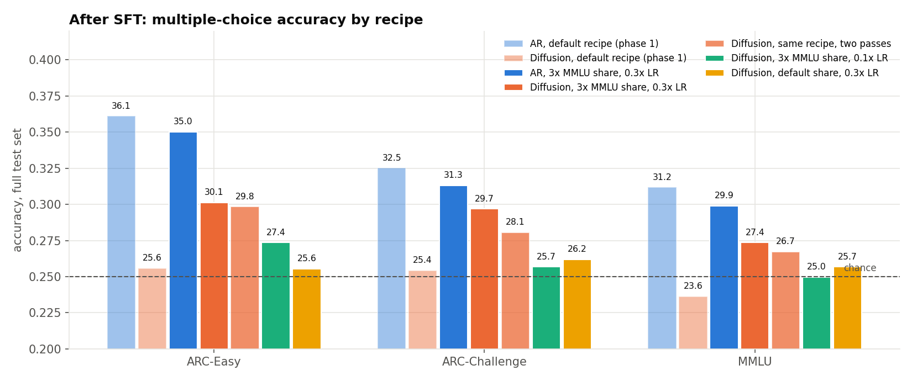

# d12 SFT recipe sweep (phase 2a)

Generated by results/plot_sft_sweep.py. Steps are optimizer steps at 524,288 tokens; a run ends after one pass over its mixture unless the epochs are raised, so the 3x-MMLU mixture gives 1375 steps per pass. Validation bpb is the exact NLL for AR and the ELBO upper bound for the diffusion model, on the same SFT validation mixture.

| run | model | recipe | steps | final val bpb | ChatCORE_cat (400/task) | ARC-E | ARC-C | MMLU | GSM8K |
|---|---|---|---|---|---|---|---|---|---|
| d12_ar_sft | AR | default recipe (phase 1) | 934 | 0.356 | +0.110 | 36.1% | 32.5% | 31.2% | 0.8% |
| d12_mdm_sft | Diffusion | default recipe (phase 1) | 934 | 0.624 | -0.002 | 25.6% | 25.4% | 23.6% | 0.0% |
| sft2_ar_m9_lr0.3_x2 | AR | 3x MMLU share, 0.3x LR | 1375 | 0.363 | +0.113 | 35.0% | 31.3% | 29.9% | 2.0% |
| sft2_mdm_m9_lr0.3_x2 | Diffusion | 3x MMLU share, 0.3x LR | 1375 | 0.632 | +0.041 | 30.1% | 29.7% | 27.4% | 0.0% |
| sft2_mdm_m9_lr0.3_ep2 | Diffusion | same recipe, two passes | 2749 | 0.590 | +0.027 | 29.8% | 28.1% | 26.7% | 0.0% |
| sft2_mdm_m9_lr0.1_x2 | Diffusion | 3x MMLU share, 0.1x LR | 1375 | 0.654 | +0.020 | 27.4% | 25.7% | 25.0% | 0.0% |
| sft2_mdm_m3_lr0.3 | Diffusion | default share, 0.3x LR | 934 | 0.632 | +0.011 | 25.6% | 26.2% | 25.7% | 0.0% |

