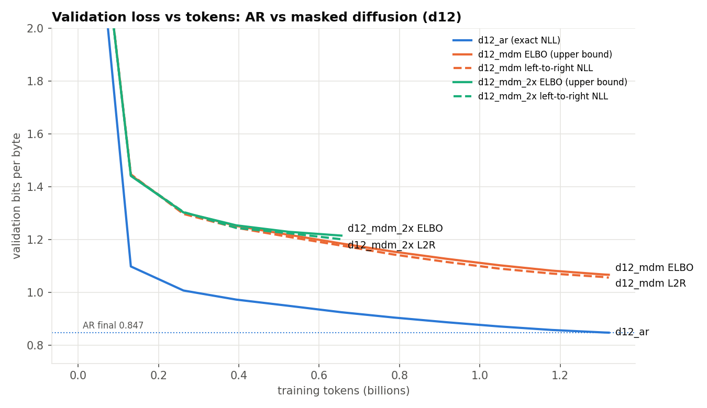
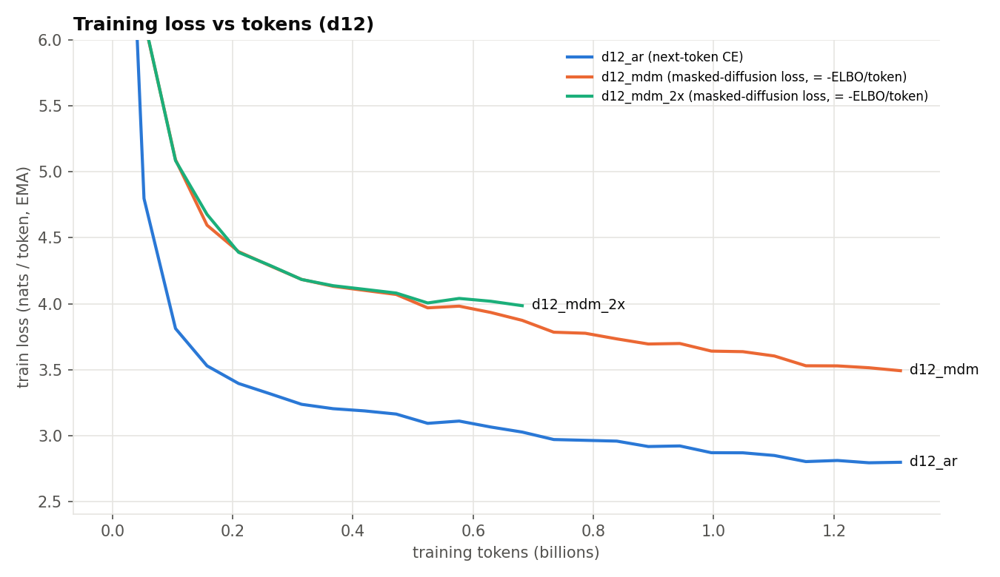
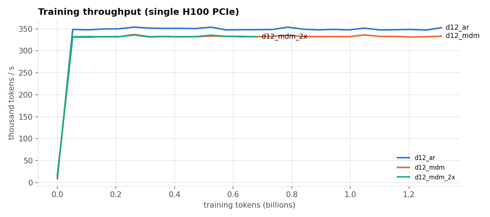
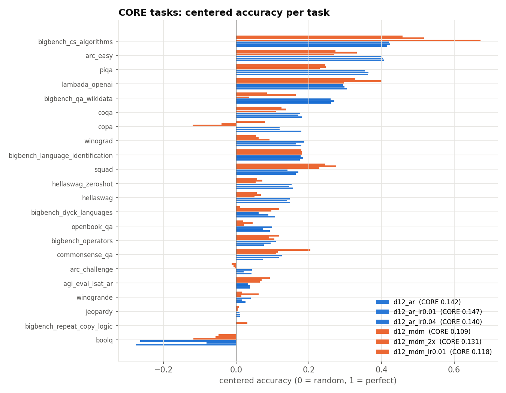

# d12 summary

Generated by results/plot.py from synced logs.

| run | type | tokens (B) | steps | val bpb (final) | val bpb L2R | CORE | train time | tok/s |
|---|---|---|---|---|---|---|---|---|
| d12_ar | ar | 1.32 | 2520 | 0.8471 | - | 0.1421 | 63 min | 349K |
| d12_mdm | mdm | 1.32 | 2520 | 1.0663 | 1.0554 | 0.1090 | 66 min | 332K |
| d12_mdm_2x | mdm | 0.68 | 1300 | 1.2146 | 1.2007 | - | 34 min | 332K |

