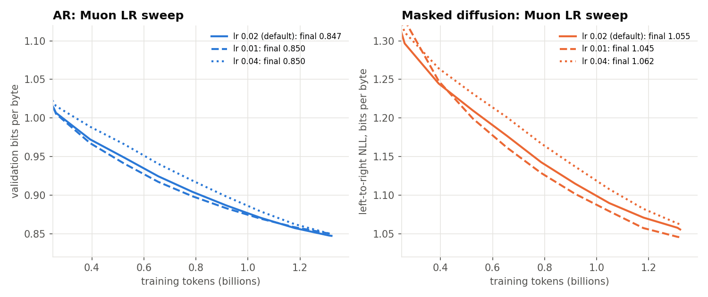
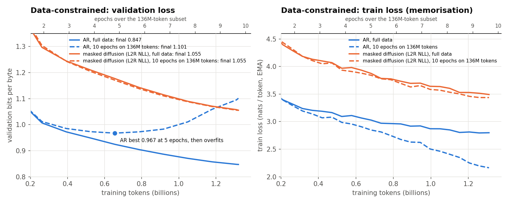
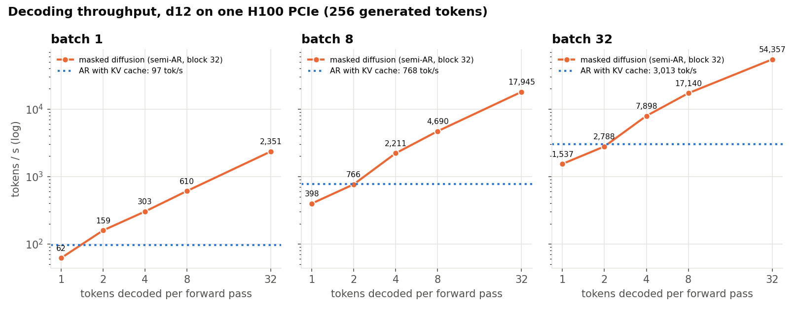

# d12 summary

Generated by results/plot.py from synced logs.

| run | type | tokens (B) | steps | val bpb (final) | val bpb L2R | CORE | train time | tok/s |
|---|---|---|---|---|---|---|---|---|
| d12_ar | ar | 1.32 | 2520 | 0.8471 | - | 0.1421 | 63 min | 349K |
| d12_ar_lr0.01 | ar | 1.32 | 2520 | 0.8497 | - | 0.1472 | 63 min | 350K |
| d12_ar_lr0.04 | ar | 1.32 | 2520 | 0.8496 | - | 0.1404 | 62 min | 351K |
| d12_ar_rep10 | ar | 1.32 | 2520 | 1.1012 | - | 0.1202 | 63 min | 349K |
| d12_mdm | mdm | 1.32 | 2520 | 1.0663 | 1.0554 | 0.1090 | 66 min | 332K |
| d12_mdm_2x | mdm | 2.64 | 5040 | 1.0221 | 1.0087 | 0.1314 | 132 min | 332K |
| d12_mdm_4x | mdm | 5.28 | 10080 | 0.9924 | 0.9790 | 0.1343 | 292 min | 333K |
| d12_mdm_lr0.01 | mdm | 1.32 | 2520 | 1.0618 | 1.0453 | 0.1180 | 66 min | 332K |
| d12_mdm_lr0.04 | mdm | 1.32 | 2520 | 1.0754 | 1.0620 | 0.1016 | 66 min | 334K |
| d12_mdm_rep10 | mdm | 1.32 | 2520 | 1.0716 | 1.0549 | 0.0848 | 66 min | 332K |

## Decoding throughput (scripts/infer_bench_mdm.py, 256 tokens after a 7-token prompt)

| decoder | tokens / forward pass | batch 1 tok/s | batch 8 tok/s | batch 32 tok/s |
|---|---|---|---|---|
| AR, KV cache | 1 | 97 | 768 | 3,013 |
| MDM, block 32, 32 steps/block | 1 | 62 (0.6x) | 398 (0.5x) | 1,537 (0.5x) |
| MDM, block 32, 16 steps/block | 2 | 159 (1.6x) | 766 (1.0x) | 2,788 (0.9x) |
| MDM, block 32, 8 steps/block | 4 | 303 (3.1x) | 2,211 (2.9x) | 7,898 (2.6x) |
| MDM, block 32, 4 steps/block | 8 | 610 (6.3x) | 4,690 (6.1x) | 17,140 (5.7x) |
| MDM, block 32, 1 steps/block | 32 | 2,351 (24.2x) | 17,945 (23.4x) | 54,357 (18.0x) |

